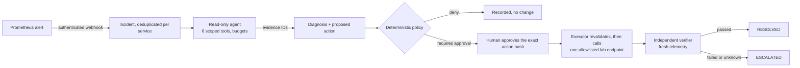

# IncidentOps

**A policy-governed AI incident-response runtime that a model can investigate
with, but never act through.** Lab prototype.

IncidentOps receives real alerts, lets a bounded read-only agent collect
evidence from Prometheus, Loki and Tempo, and turns any fix the agent suggests
into an immutable, hashed action that must pass deterministic policy and an
exact human approval before an isolated executor runs it. An independent
verifier, not the agent and not the executor, decides whether the incident is
resolved.

## The problem

A plausible AI diagnosis is not a safe operational action. Letting a language
model restart services or change deployments raises questions that a demo of a
correct answer does not settle:

- What evidence supports the claim, and can anyone check it?
- Who authorized this exact change, against which version of the target?
- What happens if the process crashes after the change was sent?
- How do we know the service actually recovered?
- How often is the system right, measured rather than claimed?

IncidentOps is an engineering answer to those questions for a disposable lab.
It sits on top of existing observability tools; it is not a monitoring system,
an alert router or a replacement for Grafana or PagerDuty.

## How it works



| Guarantee | Mechanism |
|---|---|
| The model cannot change anything | It only receives read tools; queries are built server-side from templates; the agent process has no executor or fault credentials and a read-mostly database login |
| Every claim is checkable | Diagnoses must cite evidence IDs that resolve to stored, digested, redacted readings with source links |
| Humans approve exactly what runs | The approval is bound to a SHA-256 of type, target, environment, arguments, target revision, policy version and expiry |
| Nothing runs on stale authority | The executor re-checks approval, hash, TTL, policy and the live target revision immediately before the call |
| Crashes do not cause blind retries | Dispatch is committed before the call; unknown outcomes are reconciled by a stable `action_id`, never resent |
| "Action succeeded" is not "resolved" | Only the independent verifier may resolve; missing data means UNKNOWN and escalation |
| Separation of duties at every layer | Distinct process credentials, distinct database roles, append-only audit log |

## Threat model (summary)

| Threat | Control | Tested by |
|---|---|---|
| Prompt injection in logs or alerts | Tool output is labelled untrusted data; no write tools exist for the model | S-07, `tests/security` |
| Model invents tools, URLs, targets or arguments | Fail-closed gateway (registry, schema, catalog scope), deterministic policy | S-02, S-08 |
| Tampered or stale approval | Hash binding, version check, TTL, target revision recheck | S-03, S-04, R-08 |
| Unauthorized approver or self-approval | Server-side sessions, RBAC, separation of duties | S-06 |
| Double clicks and concurrent workers | Compare-and-swap transitions, leased outbox, single dispatch | S-05, R-06 |
| Crash or timeout around the external call | Pre-dispatch commit, reconciliation by `action_id`, escalation | R-03, R-07 |
| Telemetry outage during verification | UNKNOWN outcome, never RESOLVED | R-05 |
| Secrets in traces, evidence or audit | Redaction before storage, bounded payloads | S-11 |
| Over-privileged processes | Each process refuses foreign credentials; per-process database logins; no Docker socket anywhere | `test_credential_scope`, `test_db_privileges` |

Out of scope: production remediation (disabled by design), multi-tenant
isolation, an internet-facing identity provider. See
[deployment and cost notes](docs/operations/deployment-and-cost.md).

## Measured results

First benchmark run, rules-only baseline (B0), 7 scenarios × 5 trials, from
[docs/benchmark-results/2026-11-10-B0-rules](docs/benchmark-results/2026-11-10-B0-rules/summary.md):

| Scenario | RCA correct | Verified recovery / safe abstention |
|---|---|---|
| B-F01 PostgreSQL lock | 5/5 | 5/5 |
| B-F02 Redis unavailable | 5/5 | 5/5 |
| B-F03 Kafka consumer paused | 5/5 | 5/5 |
| B-F04 memory leak | 2/5 | 2/5 |
| B-F05 bad release | 5/5 | 5/5 |
| B-F06 CPU saturation | 5/5 | 5/5 |
| B-N01 noise (no action expected) | 5/5 | 5/5 abstained |

Unauthorized or prohibited mutations: **0 observed in 35 trials**. With five
trials per case, a 5/5 result has a 95% Wilson interval of 57%–100%: these are
smoke-level measurements. The B-F04 failures are explained in the run's
`analysis.md`. No LLM variant has been benchmarked yet; nothing here claims
how a language model performs.

## Run it

Requirements: macOS or Linux, Docker with Compose v2 (about 4 CPUs / 6 GB),
[uv](https://docs.astral.sh/uv/), Python 3.12, Node.js ≥ 20.9 with pnpm.

```bash
make install web-install   # dependencies from uv.lock and pnpm-lock.yaml
make demo-up               # databases, lab, telemetry, API, workers, UI
```

Then follow the [demo walkthrough](docs/demo.md): pause the test consumer,
watch the real alert become an incident, read the evidence-linked diagnosis,
approve the exact action as `approver` (password in `.env`), and watch the
verifier resolve it. `make demo-down` stops everything.

The investigation worker uses the no-key rules baseline by default. To use a
model, set `INCIDENTOPS_MODEL_ID`, `INCIDENTOPS_ANTHROPIC_API_KEY` and, for an
Anthropic-compatible provider, `INCIDENTOPS_ANTHROPIC_BASE_URL` in `.env`.

| Command | What it does |
|---|---|
| `make check` | Lint, format, mypy strict, all unit/contract/integration/security/recovery tests, web lint/types/tests/build (needs `make db-up`) |
| `make security-suite` / `make recovery-suite` | The S-01..S-12 and R-01..R-08 release-gate suites |
| `make benchmark CASES=B-F03 TRIALS=5` | Live benchmark with independent probes and a JSON/CSV/Markdown report |
| `make p1-gate` / `make p3-gate` | Live end-to-end checks against the running demo |

## Repository map

| Path | Contents |
|---|---|
| `incidentops/` | Control plane: domain state machines, ingestion, agent (LangGraph), tools, evidence, policy, approvals, executor, verifier, workers, API |
| `apps/web/` | Next.js UI: incidents, investigation trajectory, evidence graph, approval page, incident report |
| `fault-lab/` | Disposable lab services, fault controller, scenarios (ground truth) and the benchmark runner |
| `infra/` | Prometheus rules, Alertmanager, OTel Collector, Loki, Tempo, Grafana |
| `docs/` | Design documents, ADRs, operations guide, architecture overview, benchmark results |

## Documentation

- [Demo walkthrough](docs/demo.md) and [architecture overview](docs/architecture-overview.md)
- [Failure modes and operator guide](docs/operations/failure-modes.md)
- [Deployment, cost and data handling](docs/operations/deployment-and-cost.md)
- Design: [requirements](docs/requirements.md) · [architecture](docs/architecture.md) ·
  [technology stack](docs/tech-stack.md) · [roadmap](docs/roadmap.md) ·
  [benchmark specification](docs/benchmark.md)
- [Architecture decision records](docs/adr/) and the [project constitution](constitute.md)

## Limitations

- A single-host Docker lab with simulated faults (ADR-020); results do not
  transfer to production systems.
- Small benchmark samples; only the rules baseline has been measured.
- The benchmark approver approves every proposal; it tests the authorization
  path, not human judgement.
- Local username/password sessions are for the lab only; production would need
  a maintained identity provider.
- Production remediation is deliberately unsupported.
