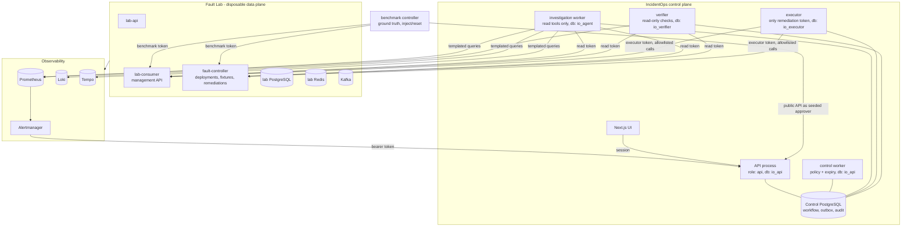

# Architecture overview (as built)

This page describes what the code does today. The design rationale lives in
[architecture.md](architecture.md); deviations are recorded as
[ADRs](adr/README.md).

## Processes and trust boundaries

Each box below is a separate process with its own credentials. Every process
refuses to start if it holds another role's credentials
(`incidentops/workers/credentials.py`) and connects to PostgreSQL with its own
least-privilege login (`incidentops/persistence/privileges.py`).



The fault controller and consumer accept three separate lab tokens: the
benchmark token (inject/reset, never given to IncidentOps), the executor token
(the allowlisted remediations only) and the read token (status, target
revisions, deployment timeline). No container mounts the Docker socket.

## The closed loop (B-F03)

```mermaid
sequenceDiagram
  participant B as Benchmark / operator
  participant W as lab-consumer
  participant P as Prometheus + Alertmanager
  participant A as API
  participant I as Investigation worker
  participant C as Control worker
  participant H as Approver
  participant E as Executor
  participant V as Verifier

  B->>W: pause (benchmark token)
  P->>A: lag alert webhook
  A->>A: upsert incident + outbox job (one transaction)
  I->>A: claim job (lease), RECEIVED -> INVESTIGATING
  I->>P: lag, status, broker, producer (read tools)
  I->>A: evidence, trajectory, diagnosis + proposal -> DIAGNOSED
  C->>W: read current generation (read token)
  C->>A: policy p2 -> envelope + action_hash -> AWAITING_APPROVAL
  H->>A: approve(action_hash, expected_version)
  A->>A: decision + audit + execute job (one transaction)
  E->>W: re-read generation; recheck hash, TTL, policy
  E->>A: commit EXECUTING + external operation
  E->>W: POST /control/resume {action_id, expected_generation}
  W-->>E: receipt (generation_after)
  E->>A: SUCCEEDED -> incident VERIFYING + verify job
  V->>W: paused=false at generation_after?
  V->>P: broker up, lag drained and staying low?
  V->>A: verification PASSED -> RESOLVED
```

## Record linkage

```text
incident -> alert events
         -> investigation run -> agent steps (model/tool, OTel trace + span IDs)
                              -> evidence (query, window, digest, redacted snapshot)
                              -> diagnosis (cited evidence IDs must resolve)
         -> action envelope (action_hash) -> approval request -> decisions
                                          -> external operation (receipt by action_id)
                                          -> verification (checks with observations)
audit_events: append-only, insert-only for every application role
```

## Where things live

| Concern | Module |
|---|---|
| State machines and contracts | `incidentops/domain/` |
| Alert ingestion and dedup | `incidentops/ingestion/` |
| Read tools, templates, gateway | `incidentops/tools/` |
| Evidence and redaction | `incidentops/evidence/` |
| Agent graph, prompt, rules baseline | `incidentops/agent/` |
| Policy | `incidentops/policy/`, `config/policy.yaml` |
| Proposals and approvals | `incidentops/actions/` |
| Executor and adapters | `incidentops/execution/` |
| Verifier | `incidentops/verification/`, `config/verification.yaml` |
| Workers and credential guard | `incidentops/workers/` |
| Database schema, roles, outbox | `incidentops/persistence/` |
| Lab services and fault controller | `fault-lab/fault_lab/` |
| Scenarios and benchmark | `fault-lab/scenarios/`, `fault-lab/fault_lab/benchmark/` |

## Console metric replay

The Story chart uses the authenticated incident metrics endpoint. Its range starts
five minutes before the first alert and ends five minutes after the terminal audit
transition (capped at the current time), or at the current time for active incidents.
Manual ownership and disposition edits do not move an audited historical boundary.
Queries remain server-side and allowlisted. Missing historical telemetry is shown
explicitly; current readings never replace a historical window.
