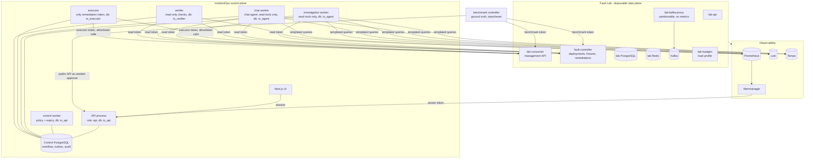

# Architecture overview (as built)

This page describes what the code does today. The design rationale lives in
[architecture.md](architecture.md); deviations are recorded as
[ADRs](adr/README.md).

## Processes and trust boundaries

Each box below is a separate process with its own credentials. Every process
refuses to start if it holds another role's credentials
(`incidentops/workers/credentials.py`) and connects to PostgreSQL with its own
least-privilege login (`incidentops/persistence/privileges.py`).



The fault controller and consumer accept three separate lab tokens: the
benchmark token (inject/reset, never given to IncidentOps), the executor token
(the allowlisted remediations only) and the read token (status, target
revisions, deployment timeline). No container mounts the Docker socket.

## The closed loop (B-F03)

```mermaid
sequenceDiagram
  participant B as Benchmark / operator
  participant W as lab-consumer
  participant P as Prometheus + Alertmanager
  participant A as API
  participant I as Investigation worker
  participant C as Control worker
  participant H as Approver
  participant E as Executor
  participant V as Verifier

  B->>W: pause (benchmark token)
  P->>A: lag alert webhook
  A->>A: upsert incident + outbox job (one transaction)
  I->>A: claim job (lease), RECEIVED -> INVESTIGATING
  I->>P: lag, status, broker, producer (read tools)
  I->>A: evidence, trajectory, diagnosis + proposal -> DIAGNOSED
  C->>W: read current generation (read token)
  C->>A: policy p2 -> envelope + action_hash -> AWAITING_APPROVAL
  H->>A: approve(action_hash, expected_version)
  A->>A: decision + audit + execute job (one transaction)
  E->>W: re-read generation; recheck hash, TTL, policy
  E->>A: commit EXECUTING + external operation
  E->>W: POST /control/resume {action_id, expected_generation}
  W-->>E: receipt (generation_after)
  E->>A: SUCCEEDED -> incident VERIFYING + verify job
  V->>W: paused=false at generation_after?
  V->>P: broker up, lag drained and staying low?
  V->>A: verification PASSED -> RESOLVED
```

## Record linkage

```text
incident -> alert events
         -> investigation run -> agent steps (model/tool, OTel trace + span IDs)
                              -> evidence (query, window, digest, redacted snapshot)
                              -> diagnosis (cited evidence IDs must resolve)
         -> action envelope (action_hash) -> approval request -> decisions
                                          -> external operation (receipt by action_id)
                                          -> verification (checks with observations)
audit_events: append-only, insert-only for every application role
```

## Where things live

| Concern | Module |
|---|---|
| State machines and contracts | `incidentops/domain/` |
| Alert ingestion and dedup | `incidentops/ingestion/` |
| Read tools, templates, gateway | `incidentops/tools/` |
| Evidence and redaction | `incidentops/evidence/` |
| Agent graph, prompt, rules baseline | `incidentops/agent/` |
| Chat agent, chat memory, re-investigation requests (ADR-023) | `incidentops/chat/` |
| Policy | `incidentops/policy/`, `config/policy.yaml` |
| Proposals and approvals | `incidentops/actions/` |
| Executor and adapters | `incidentops/execution/` |
| Verifier | `incidentops/verification/`, `config/verification.yaml` |
| Workers and credential guard | `incidentops/workers/` |
| Database schema, roles, outbox | `incidentops/persistence/` |
| Lab services and fault controller | `fault-lab/fault_lab/` |
| Scenarios and benchmark | `fault-lab/scenarios/`, `fault-lab/fault_lab/benchmark/` |

## Root causes, policy and lab coverage (ADR-024)

**Root-cause/action consistency.** `config/policy.yaml` (`p4`, now `p5`) maps each of
the 14 taxonomy root causes to the only action types that may remediate it.
The proposal evaluator passes the diagnosis' `root_cause_id` to the policy
engine; any other action type is denied with
`action_not_allowed_for_root_cause` and the incident goes to a human
(`DIAGNOSED_ONLY`). `consumer_slow`, `application_error` and
`insufficient_evidence` map to no action. The executor's pre-dispatch
re-check relies on the policy version pinned in the envelope. The prompt
states the mapping.

| Root cause | Allowed action (target) | Scenario | Kept apart from |
|---|---|---|---|
| `postgres_lock_contention` | `release_lab_db_blocker` (`lab-postgres`) | B-F01 | B-F09, B-F12 |
| `redis_unavailable` | `restart_lab_dependency` (`lab-redis`) | B-F02 | |
| `consumer_paused` | `resume_test_consumer` (`persist-demo-consumer`) | B-F03 | B-F07, B-F08 |
| `application_memory_leak` | `rollback_demo_api` (`lab-api`) | B-F04 | |
| `bad_deployment` | `rollback_demo_api` (`lab-api`) | B-F05 | B-F10, B-F13 |
| `cpu_saturation` | `stop_lab_cpu_load` (`lab-cpu-load`) | B-F06 | B-F11 |
| `kafka_broker_unavailable` | `restart_lab_dependency` (`lab-kafka`) | B-F07 | B-F03 |
| `consumer_slow` | none (human review) | B-F08 | B-F03 |
| `postgres_unavailable` | `restart_lab_dependency` (`lab-postgres`) | B-F09 | B-F01 |
| `application_error` | none (human review) | B-F10 | B-F05, B-N01 |
| `traffic_surge` | `reset_lab_load_profile` (`lab-loadgen`) | B-F11 | B-F06 |
| `connection_pool_exhausted` | `release_lab_idle_connections` (`lab-postgres`) | B-F12 | B-F01, B-F09 |
| `config_error` | `revert_lab_config` (`lab-api-config`, `target_config: cfg-1`) | B-F13 | B-F05, B-F10 |
| `insufficient_evidence` | none | B-N01 | |

Every write action is approval-required, fault-lab only and argument
allowlisted; the three newest (`reset_lab_load_profile`,
`release_lab_idle_connections`, `revert_lab_config`) have no free-form
arguments. Verification specs may be keyed per target
(`restart_lab_dependency:lab-kafka`, `...:lab-postgres`, `...:lab-redis`).
B-F07 to B-F13 have **not been run yet**; no benchmark numbers exist for them.

**Read tools.** `search_logs` covers the API and the Kafka consumer and
producer (both export logs over OTLP with their catalog `service_id`).
`get_redis_health` reads up, memory, clients and command rate.
`get_recent_config_changes` reads the lab config timeline (revisions, actors,
changed keys). `get_postgres_health` adds `connections=<used>/<max> idle=<n>`.
New templates: `api_memory_growth_rate` (B-F04 now uses the peak growth rate),
`api_request_rate_vs_baseline`, `producer_send_error_rate`,
`postgres_connection_utilization`, `postgres_max_connections`,
`redis_connected_clients`, `redis_commands_per_second`.

**Lab topology.** Kafka clients (producer, consumer, lag exporter) reach the
broker only through `lab-kafka-proxy`, which the fault controller can
partition for a bounded time (B-F07). The lab API connects as the ordinary
role `lab_app`; PostgreSQL keeps reserved slots for superusers and the
monitoring role, so idle `lab_app` sessions can exhaust ordinary slots
(B-F12). `lab-postgres` reports a composite revision
`pg-gen-<n>.lock-<digest>.pool-<digest>`. No fixture uses container control.

## Prompt, tools and confidence (ADR-025)

The investigation prompt (`investigation-v10`) has `<rules>`,
`<investigation_method>` (required evidence coverage and a stop condition, no
fixed order), `<when_no_fault_is_confirmed>` (when to answer
`insufficient_evidence`, ADR-027) and `<confidence_rubric>` sections. Every read tool description
states purpose, when to use it, what it returns and its limits, and every
parameter is described. Validation rejects `high` confidence without readings
from two tools including one non-symptom check, `low` confidence with an
action, and `insufficient_evidence` above `low`; policy `p5` also denies
proposals below `medium` (`confidence_below_minimum`).

## Console metric replay

The Story chart uses the authenticated incident metrics endpoint. Its range starts
five minutes before the first alert and ends five minutes after the terminal audit
transition (capped at the current time), or at the current time for active incidents.
Manual ownership and disposition edits do not move an audited historical boundary.
Queries remain server-side and allowlisted. Missing historical telemetry is shown
explicitly; current readings never replace a historical window.

Incident view tabs use native browser history and mounted client-side panels.
Switching tabs does not navigate the server route or repeat incident API reads;
query-string deep links and browser back/forward still select the right panel.

The Metrics workspace groups signals by service, filters incident overlays to the
matching service and polls a same-origin authenticated read proxy every 15 seconds.
Range changes and polling replace chart data locally, preserving filters and layout.
Plots show axes, thresholds, series legends, event markers and pointer/keyboard
inspection. Missing samples break the line; empty, partial, stale and failed data
are distinguished from healthy readings. Redis and PostgreSQL availability and
visible Kafka brokers use a below-threshold check rather than the above-threshold
rule used for latency and CPU. Panels added for ADR-024: API request rate vs its
30-minute median, memory growth rate (recording rule), Kafka brokers visible,
PostgreSQL availability and connection usage (threshold 90%). Every alert rule
maps to the panel that explains it.

The incident header uses the root cause and affected component as a short title,
with a bounded preview of the recorded diagnosis in normal body text. The complete
original diagnosis stays available in an expandable Investigation section; the
preview does not alter the stored model output.

Interactive metric timestamps use an explicit English locale and a shared UTC
snapshot for server rendering and initial hydration. After hydration they adopt
the browser timezone, which is shown beside the displayed range. Different host
locales or timezones cannot leave Metrics controls waiting on mismatched markup.

The chat opening effect decodes a precomputed radial texture and warms the SVG
filter during idle time (also on pointer/focus intent). An immediate cold click
uses the lightweight ring instead of blocking on preparation. Filter bounds are
limited to the viewport; ring and highlight layers animate transform/opacity.
Chat history loads after the opening effect, and temporary layers are removed
on completion, close, scroll, resize or unmount. Regenerate the lookup texture
with `python scripts/generate_chat_displacement.py`.
