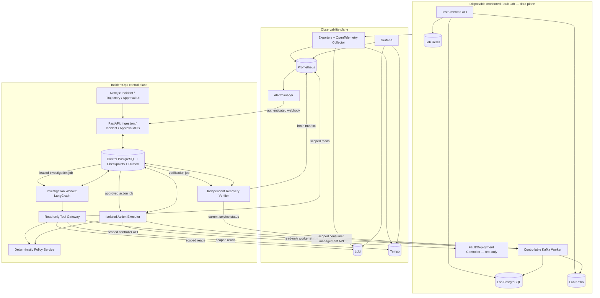
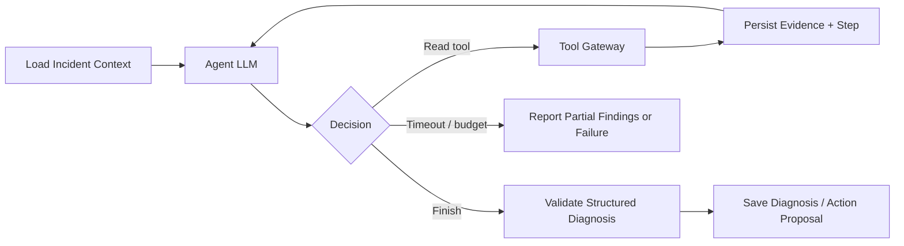

# IncidentOps — System Architecture and Execution Contracts

**Version:** 2.0 · **Status:** Proposed / not yet implemented · **Date:** 2026-11-09  
**Related:** [Requirements](requirements.md) · [Technology Stack](tech-stack.md) · [Roadmap](roadmap.md) · [Benchmark](benchmark.md)

## 1. Architectural Decision Summary

**Architectural style:** Modular FastAPI control plane + durable PostgreSQL job/outbox + LangGraph investigation worker + a **separately credentialed remediation executor** + disposable Docker Compose Fault Lab.

**Trust rule:** AI output is *untrusted intent*. Only deterministic services authorize and perform mutations. The LLM never receives Docker access, fault-controller credentials, write-enabled database connections, or privileged shell tools.

**Data rule:** Prometheus/Loki/Tempo remain the observability backends. IncidentOps stores **evidence references**, bounded redacted snapshots, workflow records, checkpoints, policies, approvals, and audit events. It does not duplicate a full telemetry warehouse.

**Runtime rule:** LangGraph owns graph orchestration/checkpointing for read-only investigation; the Incident Workflow owns incident/action/approval lifecycles; the Executor owns external side effects and reconciliation.

**First fully validated scenario:** test Kafka consumer pause, diagnosis, approval, resume, and sustained lag recovery. Other faults reuse the same infrastructure rather than introducing new workflow shapes.

## 2. Trust Boundaries and High-Level Components



**Important exclusions:** (1) The model cannot call `FC` or Docker directly. (2) The **Fault Injector / Benchmark Controller** is a distinct test harness and does not expose its ground truth to the agent. (3) No production environment has a remediation credential in the MVP. (4) A box above is a logical responsibility, not necessarily a microservice.

## 3. Ownership and Dependency Direction

| Component | Responsibilities | May mutate | Persistence / trust boundary |
|---|---|---|---|
| Alert Ingestion | Authenticate/normalize webhook, dedup | Incident and alert tables only | DB transaction + outbox |
| Incident Workflow | Canonical status machine, escalation, verification ownership | Incident domain state | DB conditional updates |
| Investigation Runtime | Bounded model/tool reasoning; typed diagnosis | Own run/checkpoint state; no infrastructure mutations | LangGraph checkpointer |
| Tool Registry/Gateway | Validate args, scoped read authorization, limit, execute, redact, emit trace | Observation/evidence tables | Only read-only connector credentials |
| Evidence Service | Provenance, digest, redacted snapshots, citations | Evidence records | Control DB and telemetry links |
| Policy Service | Deterministic allow/deny/approval decision | Policy-decision records | Versioned, fail-closed |
| Approval Service | Verify approver; bind decision to action hash/revision/TTL | Approval records + outbox | Transactional state change |
| Action Executor | Claim approved job, revalidate, invoke allowlisted operation | External *lab* target | Isolated credentials/network |
| Reconciliation Worker | Resolve ambiguous results via operation status and state | Action state, never blind replay | External controller status |
| Recovery Verifier | Check fresh health window and expected postcondition | Verification + incident status | Independent read-only credential |
| Trajectory Recorder | Record observable agent/model/tool events | Run-step table / OTel spans | Redacted, bounded retention |
| Audit Service | Append security-critical events | Append-only audit records | Transactional events; limited write role |
| Fault Lab Controller | Inject/reset known faults | Disposable lab only | Outside agent trust boundary |
| Benchmark Runner | Ground truth, trial orchestration, grading | Test fixtures/results | Ground truth kept separate |

## 4. Canonical Vertical Slice: Kafka Consumer Pause / Resume

### 4.1 Preconditions

- The Fault Lab contains a **producer** that continues emitting messages to a dedicated test topic, plus a **controllable worker** in a test consumer group.
- The worker exposes `GET /control/status` and `POST /control/resume` on a management-only network, authenticating the executor. The resume operation is **target-state idempotent**: requesting `paused=false` repeatedly converges to unpaused; it logs the stable `action_id` and offers `GET /control/operations/{action_id}`.
- The benchmark controller can pause the worker via **separate test-only access**; the agent cannot invoke this injection endpoint.
- A Kafka lag source exports per-group/partition lag; Prometheus observes it and alerts after a configured sustained threshold. The lag exporter and metric labels are validated in integration tests.
- A healthy broker and active producer are distinguishable from a paused consumer using separate metrics.

### 4.2 Sequence

```mermaid
sequenceDiagram
  participant FI as Fault Injector (test only)
  participant CW as Consumer Worker
  participant AM as Alertmanager
  participant API as IncidentOps API
  participant PG as Control Postgres
  participant AG as LangGraph Agent
  participant TG as Read Tool Gateway
  participant HU as Authorized Approver
  participant EX as Action Executor
  participant VF as Recovery Verifier

  FI->>CW: pause consumer (test control)
  AM->>API: lag alert webhook
  API->>PG: atomically upsert incident + job
  AG->>PG: claim job/load checkpoint
  AG->>TG: query lag, worker status, broker health
  TG-->>AG: redacted readings + evidence IDs
  AG->>PG: persist diagnosis + action proposal
  API->>PG: evaluate policy; create approval request
  HU->>API: approve exact target/action/revision
  API->>PG: atomic approval + outbox action job
  EX->>PG: lease approved action
  EX->>PG: revalidate hash/TTL/policy/revision
  EX->>CW: POST /control/resume {action_id, expected_generation}
  CW-->>EX: operation accepted/result
  EX->>PG: persist confirmed outcome or RECONCILING
  VF->>CW: read fresh worker status
  VF->>PG: read independent Prometheus lag window
  VF->>PG: persist verification + RESOLVED or ESCALATED
```

For a real UI demo, **an authorized local test user** explicitly approves. Automated benchmarks use a seeded test approver identity with the same backend auth checks; never hard-code an approval bypass in application code.

## 5. Three Separate State Machines

Mixing these states in one `status` column creates fragile recovery semantics.

### 5.1 Incident

```text
RECEIVED → TRIAGED → INVESTIGATING → DIAGNOSED
                                    ├──→ DIAGNOSED_ONLY (terminal)
                                    ├──→ INSUFFICIENT_EVIDENCE → ESCALATED
                                    └──→ AWAITING_APPROVAL → EXECUTING → VERIFYING → RESOLVED
                                                            |             |
                                                            └→ ESCALATED  └→ ESCALATED
```

Additional terminal states: `FAILED` (platform/internal failure) and `CANCELLED` (authorized cancellation). Incident transitions are performed **only by Incident Workflow** after checking domain invariants; the agent returns findings rather than setting lifecycle status.

### 5.2 Investigation run

`QUEUED → RUNNING → COMPLETED | FAILED | CANCELLED | BUDGET_EXCEEDED`

A `COMPLETED` run means it returned a valid diagnosis artifact, which may report **uncertainty**. It does not mean the incident or remediation succeeded. `FAILED` means agent execution ended with an error; benchmark infrastructure outages may instead be classified `INVALID` by the evaluator.

### 5.3 Proposed action and approval

```text
ACTION: PROPOSED
    ├── POLICY_DENIED (terminal)
    └── PENDING_APPROVAL
         ├── REJECTED (terminal)
         ├── EXPIRED (terminal)
         └── APPROVED → QUEUED → EXECUTING
                                ├── SUCCEEDED → verification record
                                ├── FAILED → escalation / reproposal
                                └── RECONCILING → SUCCEEDED | FAILED | ESCALATED

APPROVAL: PENDING → APPROVED | REJECTED | EXPIRED | REVOKED
```

`ACTION.SUCCEEDED` only confirms that the external operation met its **action-level** outcome contract; `INCIDENT.RESOLVED` requires **independent verification**.

**Transactional transition contract:** update by `WHERE id=:id AND state=:expected AND version=:v`, increment version, and write associated audit/outbox event in the same transaction. Reject zero-row updates with conflict (HTTP 409), not a silent retry.

## 6. Investigation Runtime: LangGraph + Custom Harness

### 6.1 Boundaries

**LangGraph provides:** graph routing, state update/checkpoints, bounded agent/tool graph, optional interruptions, and later subgraphs.  
**Custom IncidentOps provides:** `RunManager`, model adapter, context preparation, deterministic tool/policy enforcement, evidence normalization, trajectory store, incident state machine, action proposal validation, approval, executor, and reconciliation.

The **production investigation graph** should remain small:



A simple standalone ReAct loop may be retained as a **reference baseline** for education/experiments; it is not the production workflow implementation and must not be maintained as a second fully featured runtime.

### 6.2 Agent state contract

```python
from typing import TypedDict, Literal

class InvestigationState(TypedDict):
    incident_id: str
    run_id: str
    incident_snapshot_version: int
    status: Literal["RUNNING", "COMPLETED", "FAILED", "BUDGET_EXCEEDED"]
    messages: list[dict]           # bounded; model-visible subset only
    evidence_ids: list[str]
    current_hypotheses: list[dict]
    step_count: int
    tool_call_count: int
    token_usage: int | None
    deadline_epoch_ms: int
    diagnosis_id: str | None
    error_code: str | None
```

This is a conceptual shape, not the complete validated schema. Use `Pydantic` for API/tool payloads; checkpoint serializer and schema migrations must be versioned. Do not place raw multi-megabyte log text in checkpoint state.

### 6.3 Run manager and context building

- Create one `run_id`/checkpoint thread per investigation attempt; tie it to a stable `incident_id` and incident version.
- Build model context from system instructions, incident summary, **bounded** evidence summaries, unresolved questions, and schemas of registered read-only tools.
- Tool output is untrusted and subject to input-size, token, URL, and exfiltration checks.
- Store larger source evidence outside model context; pass stable `evidence_id`s instead.
- Persist `model_id`, prompt/config version, policy version, and step/tool budgets for each run.
- On resume, verify incident has not been cancelled or materially superseded; do not let stale diagnosis directly authorize new actions.

**Default budgets (adjust after testing):** 20 graph steps, 40 tool attempts, 5-minute wall clock; read query window 60 min; all adapter timeouts and result sizes fixed per registry entry.

### 6.4 Terminal output

```json
{
  "incident_id": "inc_kafka_0042",
  "diagnosis": {
    "root_cause_id": "consumer_paused",
    "affected_component": "persist-demo-consumer",
    "confidence_level": "high",
    "summary": "The test consumer is paused while the broker and producer remain healthy.",
    "supporting_evidence_ids": ["ev_lag_17", "ev_status_19"],
    "contradicting_evidence_ids": [],
    "unresolved_questions": []
  },
  "proposed_action": {
    "action_type": "resume_test_consumer",
    "environment": "fault-lab",
    "target_id": "persist-demo-consumer",
    "arguments": {"desired_paused": false},
    "reason": "Restore consumption for the registered test worker.",
    "evidence_ids": ["ev_lag_17", "ev_status_19"]
  }
}
```

`confidence_level` is categorical, not an empirically calibrated probability. `proposed_action` may be `null` with `needs_human_review=true` when evidence is weak or there is no safe action.

### 6.5 Optional multi-agent structure

Only after M2, the supervisor may dispatch isolated-context read-only Metrics/Logs/Traces agents. Each receives scoped incident metadata and its own tool subset, returns **structured findings and evidence references**, and has a `parent_run_id`. The supervisor does not get executor permissions. Benchmark against **single agent + parallel reads** as well as a rules-only baseline.

## 7. Tool Registry and Gateway

### 7.1 Static manifest

Each tool is registered **before** a run. No dynamically generated executable tools or arbitrary URLs.

```yaml
tool_name: get_kafka_consumer_lag
version: 1
input_schema: KafkaLagRequest
risk: READ
allowed_environment: [fault-lab]
allowed_resources: [persist-demo-consumer]
timeout_ms: 3000
max_response_bytes: 16384
max_calls_per_run: 10
circuit_breaker: {failure_threshold: 5, reset_seconds: 30}
```

**Required pipeline:** validate input → canonicalize environment/resource → authorize principal/scope → enforce budgets/rate limits → execute bounded read → redact/normalize → persist Evidence → emit trajectory span/event → return structured result/error. Always record failed attempts as well as successful calls.

**Initial read tools:**

```text
query_metrics(template_id, service_id, start, end, parameters)
search_logs(service_id, start, end, severity, contains, limit)
search_traces(service_id, start, end, status, min_duration_ms, limit)
get_trace(trace_id)
get_postgres_health(service_id)
get_redis_health(service_id)
get_kafka_consumer_lag(consumer_group_id)
get_consumer_status(worker_id)
get_container_health(service_id)
get_recent_deployments(service_id, start, end)
```

Prefer predeclared PromQL/LogQL templates; if arbitrary queries are ever added, require AST/syntax checks, label matchers, query-cost guardrails, read-only scopes, and strict output limits. Network destinations and credentials come from server-side configuration, never from model arguments.

**Tool result example:**

```json
{
  "tool_call_id": "tc_87",
  "status": "SUCCESS",
  "evidence_id": "ev_lag_17",
  "observed_at": "2026-11-09T12:00:00Z",
  "source": "prometheus",
  "summary": "Lag increasing for persist-demo-consumer",
  "reference": {"template_id": "kafka_group_lag", "time_window_seconds": 180},
  "truncated": false
}
```

## 8. Evidence, Trajectory, Audit and Checkpoint are Different Systems

| Mechanism | Question answered | Persistence and characteristics |
|---|---|---|
| **Evidence** | What measured fact supports this hypothesis? | Query template, source ID, time bounds, redacted snapshot, digest, TTL/retention |
| **Trajectory** | What observable steps/tools/models ran, and when? | Append step records + OpenTelemetry spans; redacted, bounded payloads |
| **Checkpoint** | What state is needed to resume the graph? | PostgreSQL LangGraph checkpointer; versioned, consistent recovery point |
| **Audit log** | Who requested, denied, approved, dispatched, changed, or verified what? | Append-only authenticated security-relevant events |

**Canonical linkage:** `incident_id → investigation_run_id → step_id/tool_call_id → evidence_id → diagnosis_id → action_id → approval_id → external_operation_id → verification_id`.

**No hidden reasoning capture:** only observable input/output summaries and externally visible actions. Every audit event should include actor/principal, event type, resource, action hash if relevant, decision, reason, policy version, timestamp, and correlation IDs. Hash chaining may detect some tampering but is not a complete immutable-storage guarantee.

## 9. Policy, Approval, and Executor

### 9.1 Policy evaluations

Input is a **normalized** tuple `{principal, operation_id, environment_id, registered_target_id, arguments, current_target_revision, risk_class, policy_version}`. Output is one of `ALLOW`, `DENY`, `REQUIRES_APPROVAL`, with machine-readable `reason_code`. Policy errors and unrecognized operations **deny**.

| Operation | Fault Lab | Optional staging | Production |
|---|---|---|---|
| Scoped metrics/logs/trace queries | Allow | Allow if authorized | Not integrated in MVP |
| `resume_test_consumer` | Human approval | Not configured by default | Deny |
| `rollback_demo_api` | Human approval | Only with explicit separate adapter/policy | Deny |
| Known fixture `release_lab_db_blocker` | Human approval | Deny | Deny |
| Arbitrary shell, delete DB, dynamic image URL | Deny | Deny | Deny |

### 9.2 Immutable action and approval envelope

```json
{
  "action_id": "act_0032",
  "action_type": "resume_test_consumer",
  "environment": "fault-lab",
  "target_id": "persist-demo-consumer",
  "target_revision": "worker-generation-8",
  "arguments": {"desired_paused": false},
  "requested_by": "agent-run-0042",
  "evidence_ids": ["ev_lag_17", "ev_status_19"],
  "policy_version": "p1",
  "expires_at": "2026-11-09T12:15:00Z",
  "action_hash": "sha256:computed-over-canonical-versioned-envelope"
}
```

Canonical serialization (e.g., deterministic JSON encoding) is required before hashing. The hash **must include** action type, target, environment, normalized args, target revision, expiration/approval binding, and schema version. The approver authorizes this exact envelope, not an open-ended capability. Revalidate on dispatch and immediately before the provider call.

### 9.3 Approval transaction

1. Validate authenticated approver, RBAC, separation of duties, current action/incident state, hash, TTL and policy version.
2. In one DB transaction: lock action/approval row; atomically set decision; append audit event; enqueue **outbox action job**.
3. If two approvers click concurrently, exactly one legal transition wins; subsequent requests receive the current decision or 409, and must not enqueue a second action.
4. Recheck at executor: still approved, within TTL, matching target revision, policy unchanged or safely re-evaluated.

### 9.4 Independent executor API

**No `execute_shell` tool.** The executor resolves an allowlisted `action_type + target_id` to a hardcoded controller adapter and predefined resource identity.

```python
class RemediationAdapter(Protocol):
    async def apply(self, request: ApprovedAction) -> OperationReceipt: ...
    async def get_operation(self, action_id: str) -> OperationStatus: ...
    async def inspect_target(self, target_id: str) -> TargetState: ...
```

For `resume_test_consumer`: `POST /control/resume` accepts `action_id`, desired pause state, and `expected_generation`; it must expose operation status for reconciliation. **Kafka itself has no generic broker API to resume a consumer group**; this is a facility of the lab worker.

For `rollback_demo_api`: a **versioned deployment controller** stores approved image digests/manifests; it can request a controlled replacement via Docker Engine/Compose integration. Docker restart **does not roll back** a version. Keep the Docker daemon socket confined to the controller, on a disposable lab host with minimal scope/isolation; do not mount it into the agent or API.

### 9.5 Reliable dispatch and unknown outcomes

```text
APPROVED + outbox job
    → claimed with lease
    → precondition recheck
    → dispatch external operation(action_id)
    → record receipt
         ├── confirmed complete → SUCCEEDED → VERIFYING
         ├── confirmed failed → FAILED → ESCALATED
         └── network timeout/crash ambiguity → RECONCILING
              → query operation(action_id) and inspect target
              → classify confirmed result OR ESCALATE if unverifiable
```

**Do not promise exactly-once delivery.** PostgreSQL leased jobs deliver **at least once**. Target-state idempotence, stable operation IDs, database transition guards and read-after-write reconciliation reduce duplicate effects. If external status cannot be determined, **stop and escalate** instead of automatically retrying an irreversible mutation.

**Crash point example:** remote resume accepted; process dies before DB response commit. On restart, lookup `action_id` against controller, confirm worker unpaused and generation, update action without replaying unbounded side effects.

## 10. Recovery Verification

The verifier is independent of the agent/LLM and executor success message. It reads **fresh** metrics and target status after execution, evaluates an observation window, and writes `VerificationResult` with evidence references.

For Kafka pause/resume:

- Confirm registered consumer reports `paused=false` and expected worker generation/status.
- Confirm producer/broker healthy during the run.
- Confirm total/maximum partition lag **trends downward** and reaches a scenario-defined limit within timeout; avoid comparing two isolated samples only.
- If producer rate exceeds consumer capacity, escalate with evidence instead of reporting a false success.

For rollback: confirm image digest/version, readiness, API 5xx rate, P95 latency, and relevant resource metric over a sustained window. A verified action completion without metric recovery is `VERIFICATION_FAILED` at the incident layer.

## 11. PostgreSQL Data Model

Recommended tables (field lists abbreviated; use migrations and explicit uniqueness constraints):

| Table | Key fields / indexes | Invariants |
|---|---|---|
| `incidents` | id, source_fingerprint, service_id, env, status, version, timestamps | one active incident per configured dedup key |
| `alert_events` | id, incident_id, source_event_id, payload_digest, received_at | retain repeated deliveries |
| `investigation_runs` | id, incident_id, checkpoint_thread_id, status, budgets, model_version | explicit attempt identity |
| `agent_steps` | id, run_id, parent_step_id, kind, timing, status, sanitized metadata | unique step IDs; no secrets |
| `evidence` | id, incident_id, run_id, source, query_ref, time_window, digest, snapshot | source provenance |
| `diagnoses` | id, run_id, root_cause_id, hypotheses, cited_evidence_ids | immutable version per report |
| `action_proposals` | id, diagnosis_id, target, type, canonical_args, target_revision, hash, state, version | immutable payload after proposal |
| `approval_requests` | id, action_id, requested_by, expires_at, policy_version, decision | one active request/action |
| `approval_decisions` | id, approval_id, approver_id, decision, reason, timestamp | append decision history |
| `external_operations` | action_id, provider, provider_operation_id, status, receipt | unique action/provider operation mapping |
| `verifications` | id, action_id, checks, start/end, result, evidence_refs | independently measured |
| `audit_events` | id, seq, actor, event_type, action_hash, policy_version, details_digest | append-only app role |
| `outbox_jobs` | id, kind, aggregate_id, available_at, lease_owner, lease_until, attempts, status | dedup dispatch; claim safely |
| `policy_versions` | id, config_digest, created_at, active | immutable versions |

Use one **control-plane** PostgreSQL deployment or schema independent of the **monitored lab** PostgreSQL so an injected DB fault does not destroy IncidentOps state. The first release may use separate databases or containers; document the isolation level.

## 12. API Surface (illustrative, versioned)

| Route | Method | Purpose | Roles |
|---|---|---|---|
| `/api/v1/alerts/alertmanager` | POST | Authenticated alert ingestion | Alertmanager service account |
| `/api/v1/incidents` | GET | Filter incidents | Viewer+ |
| `/api/v1/incidents/{id}` | GET | Incident detail | Viewer+ |
| `/api/v1/incidents/{id}/timeline` | GET | Mixed trajectory + audit references | Viewer+ |
| `/api/v1/incidents/{id}/investigations` | POST | Start/retry authorized investigation | Operator+ |
| `/api/v1/investigations/{run_id}` | GET | Run status + evidence links | Viewer+ |
| `/api/v1/actions/{id}` | GET | Immutable action/approval/execution state | Viewer+ |
| `/api/v1/actions/{id}/approve` | POST | Approve action hash with expected version | Approver only |
| `/api/v1/actions/{id}/reject` | POST | Reject with reason | Approver only |
| `/api/v1/actions/{id}/cancel` | POST | Cancel eligible pending action | Authorized operator |
| `/api/v1/incidents/{id}/report` | GET | Diagnosis, action and verification report | Viewer+ |

Every mutation requires authenticated principal, request ID, idempotency key where appropriate, and expected resource version. Workers use internal interfaces, not public `approve` endpoints.

## 13. UI and User Journey

**Incident List → Incident Detail → Evidence Graph / Agent Trajectory → Proposed Action → Approval Decision → Execution Timeline → Independent Verification → Final Report.**

- Link to Grafana for raw metrics/logs/traces; do not reimplement high-volume dashboards.
- Show evidence confidence and contradictory findings; separate diagnosis from confirmed cause.
- Show tool validation/denial and redacted arguments, not secrets or hidden reasoning.
- Show exact approved `action_hash`, target version, expiration, actor, and subsequent state changes.
- Highlight `RECONCILING` and `VERIFICATION_FAILED` as different failure modes.

## 14. Failure Matrix and Recovery Semantics

| Failure | Detection | Required behavior | Test ID |
|---|---|---|---|
| Duplicate Alertmanager webhook | same dedup key/fingerprint | one active incident, retain event | R-01 |
| Model timeout/invalid output | model adapter | bounded retries, explicit failed/partial run | R-02 |
| Investigation worker crash | lease expired + checkpoint | resume committed state, no fabricated result | R-02 |
| Approval double-click | row version or lock | one decision and one outbox job | S-05 |
| Expired approval | TTL recheck | no dispatch | S-03 |
| Target revision changed | compare target generation | block stale approval | S-04 |
| External API timeout after accept | missing receipt, operation query | `RECONCILING`, inspect action_id before retry | R-03 |
| Verifier cannot access Prometheus | bounded read timeout | `UNKNOWN`/escalate, not `RESOLVED` | R-05 |
| Prompt injection in log | strict tool boundary | no elevation or unauthorized mutation | S-07 |
| Missing ground-truth fixture | benchmark setup check | classify trial INVALID; do not score as model failure | B harness |

## 15. Deployment, Isolation and Security Controls

- Run **Control DB**, web/API, investigation worker, executor, and benchmark/fault-controller in logically distinct networks/identities where practical. The executor is the only component able to invoke remediation endpoints.
- Keep model key, connector tokens, approver sessions, executor credentials, and benchmark fixture credentials in separate secret scopes; do not embed secrets in Git or traces.
- TLS/authenticate service edges where deployment requires; for local lab, use network isolation and explicit auth even when traffic is internal.
- Reject arbitrary model-provided IPs, network URLs, commands, images, SQL, and external callback destinations.
- Record policy decisions and security events transactionally. A policy engine outage means **DENY** for writes.
- Restrict raw log retention and use redaction to avoid copying personal data into the LLM and trace store.

## 16. Architecture Decision Records (summary)

| ADR | Choice | Rationale | Revisit trigger |
|---|---|---|---|
| ADR-001 | LangGraph for bounded read-only investigation | Avoid rebuilding graph persistence | Measured need for custom control flow beyond framework |
| ADR-002 | Modular monolith + independent executor | Strong clear security boundary with manageable operations | Team/service scale demands distribution |
| ADR-003 | Control PostgreSQL + outbox/leases | Transactional approval and workflow state | Scale or latency proves a workflow engine needed |
| ADR-004 | Prometheus/Loki/Tempo as telemetry sources | Reuse established observability storage | Cloud integrations require adapters |
| ADR-005 | Docker Fault Lab and controller | Repeatable bounded side effects | Optional Kubernetes/staging adapter |
| ADR-006 | No self-optimizing agent | Keeps evaluation and policy changes deliberate | **Out of scope**, no planned revisit |
| ADR-007 | Single agent first | Establish truthful baseline and simpler debugging | M2 measured parallelism/quality benefit |

## 17. Open Engineering Questions (resolve before implementation)

1. Which provider/model supports reliable tool calling with acceptable cost and configured telemetry retention? Document exact model/version in benchmark metadata.
2. Which Kafka lag metric source/exporter and consumer pause/status API behavior will the lab standardize? Contract-test labels and offsets.
3. What precise **controller-level** operation lookup and version pinning will implement rollback/resume reconciliation?
4. Which UI authentication mechanism and local identity seeding will be used for M1? Ensure real server-side authorization.
5. What sanitized evidence retention window is practical for local demos? Define before recording full run data.

These are explicit decisions to finalize in Phase 0; do not silently substitute weaker semantics during implementation.
