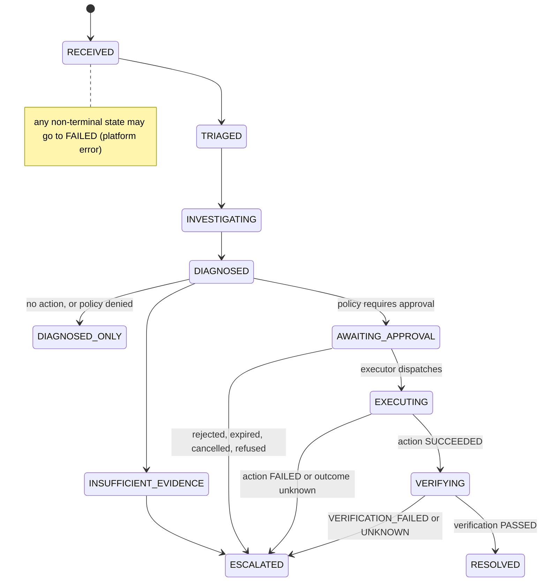
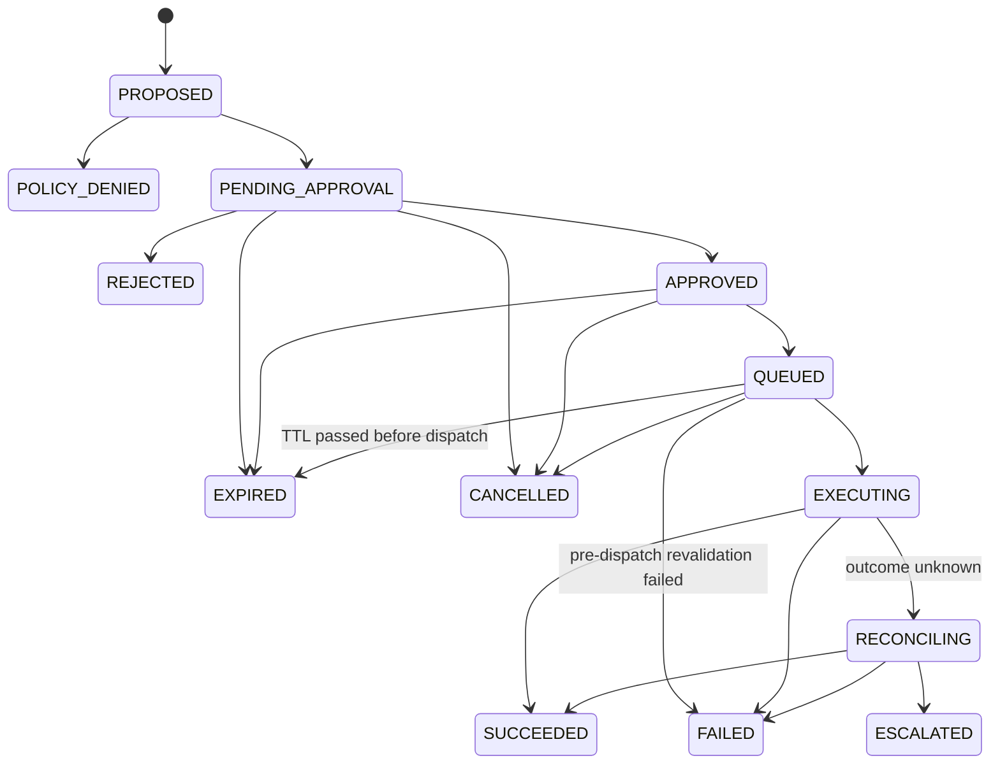

# Failure Modes and Operator Guide

How IncidentOps behaves when something goes wrong, and what an operator should
do. Every path below is covered by the safety (`make security-suite`) or
recovery (`make recovery-suite`) suites. Nothing here describes measured
benchmark results.

## Lifecycles

Three separate state machines (architecture §5). Only the independent verifier
can move an incident to `RESOLVED`.

## Incident escalation reasons

| `escalation_reason` | Meaning | Operator action |
|---|---|---|
| `insufficient_evidence` | The agent (or an exhausted budget) could not support a root cause | Review the run's evidence; investigate manually |
| `policy_<reason_code>` (state `DIAGNOSED_ONLY`) | The proposed action was denied by policy, e.g. `policy_arguments_not_allowed`, `policy_production_disabled`, `policy_missing_target_revision` | No mutation happened. Check the proposal on the action page; fix the prompt/policy if the denial is a false positive |
| `approval_rejected` | An approver rejected the exact action | Nothing was executed; follow the approver's reason |
| `approval_expired` | Nobody approved within the TTL, or the TTL passed before dispatch | Nothing was executed; re-investigate if the fault persists |
| `action_cancelled` | An operator cancelled before dispatch | Nothing was executed |
| `action_failed` | The controller refused the action, or a pre-dispatch check failed (see the action's `reason_code`) | Inspect the target; propose again if appropriate |
| `outcome_unknown` | The external result could not be determined after reconciliation attempts | **Check the target manually** before doing anything: the action may or may not have been applied. It will never be re-sent automatically |
| `verification_failed` | The action ran but the service did not recover within the window | Investigate further; the root cause may be different or the producer may outpace the consumer |
| `unknown` | The verifier lacked fresh data (e.g. Prometheus down) | Restore telemetry, then check recovery manually; the incident was deliberately not resolved |
| `model_error`, `harness_<Error>` (state `FAILED`) | The investigation itself failed | Check worker logs and model configuration; the incident needs a fresh investigation |

## Action reason codes

| `reason_code` | Where | Meaning |
|---|---|---|
| `arguments_not_allowed`, `production_disabled`, `target_not_allowlisted`, `unknown_operation`, `environment_not_allowed`, `missing_target_revision`, `policy_error` | `POLICY_DENIED` | Deterministic policy refused the proposal (fail closed) |
| `approval_rejected` / `approval_expired` | `REJECTED` / `EXPIRED` | Human decision or TTL |
| `approval_not_valid` | `FAILED` before dispatch | The approval was missing or no longer `APPROVED` |
| `action_hash_mismatch` | `FAILED` before dispatch | The stored envelope no longer matches the approved hash (tampering) |
| `policy_version_changed`, `policy_<reason>` | `FAILED` before dispatch | Policy changed or now denies the action |
| `target_unreachable`, `stale_target_revision` | `FAILED` before dispatch | The target could not be inspected, or changed since approval |
| `rejected_<detail>` | `FAILED` after dispatch | The controller definitively refused (e.g. stale generation) |
| `not_applied` | `FAILED` after reconciliation | The controller confirms it never applied this action ID |
| `outcome_unknown` | `ESCALATED` | Reconciliation could not determine the outcome |

## Reading `RECONCILING`

`RECONCILING` means a request may have reached the controller but no receipt
was recorded (timeout, crash). The executor only looks the operation up by its
stable `action_id`; it never sends the mutation again. The UI shows a separate
warning for this state, distinct from `VERIFICATION_FAILED`, which means the
action is known to have run but the service did not recover.

## Crash behaviour

| Crash point | What survives | What happens next |
|---|---|---|
| Investigation worker killed mid-run | Committed evidence and steps | Lease expires; the next worker closes the old run as `worker_lost` and starts a new run |
| API killed inside an approval transaction | Nothing from that transaction | The retried approval succeeds exactly once; duplicates get 409 |
| Executor killed after the controller accepted | `EXECUTING` + the `external_operations` row | The next attempt reconciles by `action_id`; no second call |
| Verifier killed during the observation window | The incident stays `VERIFYING` | Lease expires; a new verifier runs the full check |
| Any worker alive but slow | Its lease (heartbeat every third of the lease) | Other workers cannot steal the job |

## Credentials and database roles

Each process starts only with its own credentials and refuses others
(`workers/credentials.py`) and connects with its own database login
(`persistence/privileges.py`, migration 0004). If a process fails at startup
with `CredentialScopeError`, start it through its `make` target, which strips
foreign variables from `.env`.
