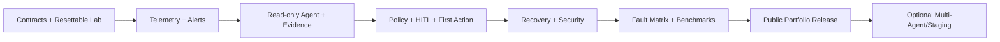

# IncidentOps — Implementation Roadmap and Release Gates

**Version:** 2.0 · **Status:** Proposed / not yet implemented · **Date:** 2026-11-09  
**Related:** [Requirements](requirements.md) · [Architecture](architecture.md) · [Technology Stack](tech-stack.md) · [Benchmark](benchmark.md)

## 1. Strategy and Execution Order

Deliver a **working, safe vertical slice** early, then deepen reliability and evaluation. Do not write every connector or a multi-agent system before proving the first end-to-end incident recovery.

**Development order:**

1. **Read-only slice:** injected API/DB issue → real Prometheus alert → typed read-only Agent diagnosis with evidence.
2. **First closed loop:** test Kafka consumer pause → agent diagnosis → deterministic policy → persisted HITL → controlled resume → independently verified lag recovery.
3. **Engineering hardening:** trace/audit completeness, approval integrity, crash and unknown-outcome reconciliation.
4. **Scenario expansion:** Redis, DB, CPU, memory, bad deployment and no-action cases.
5. **Reproducible Benchmark:** deterministic grading, baselines, repeated trials, safety and recovery suites.
6. **Optional validation:** multi-agent compared with single-agent + parallel reads; LivePulse staging integration.

Time ranges are **planning estimates** for a solo developer with working knowledge of Docker/Kafka/FastAPI; they are not delivery commitments. Advance only when the gate passes. Reduce optional features rather than weakening safety tests.

## 2. Milestone Overview

| Phase | Suggested time | Deliverable | Must-pass gate |
|---|---|---|---|
| **P0. Contracts & Lab Foundation** | Week 1 | Repository, two separated databases, healthy test service stack | Fresh-clone compose + test baseline |
| **P1. Telemetry & Incidents** | Weeks 2–3 | Real alerts, metrics/logs/traces, deduped incidents | Injected fault creates correct incident |
| **P2. Read-Only Agent Runtime** | Weeks 3–4 | LangGraph + Tool Gateway + evidence + trajectory | Diagnoses API/DB symptom with source-linked evidence |
| **P3. First Safe Remediation** | Weeks 5–6 | Kafka pause/resume + policy + approvals + executor + verifier | Full authorized recovery without direct agent writes |
| **P4. Durability & Security** | Weeks 7–8 | Outbox leases, reconciliation, crash/approval tests | No unauthorized action; recover specified crash points |
| **P5. Fault Matrix & Benchmark** | Weeks 9–10 | Six fault families, deterministic graders, baselines | Machine-readable reproducible report |
| **P6. Portfolio Release** | Week 11 | Demo, architecture diagrams, CI, failure report | Independent reviewer completes documented demo |
| **P7. Optional Experiments** | Later | Multi-agent and LivePulse staging | Only with matched benchmark comparison |

## 3. P0 — Contracts and Fault-Lab Foundation

**Goal:** One-command bootstrap, strictly separated test-control credentials and control-plane persistence.

### Tasks

- [ ] Create mono-repo and `docs/` cross-links; add `.env.example`, no secrets.
- [ ] Lock model/runtime/infra versions using Python dependency locks, `package-lock`/`pnpm-lock`, Docker image digests where practical.
- [ ] Set up FastAPI, Next.js, SQLAlchemy/Alembic, Control PostgreSQL, pytest, linting/type-checking, and CI smoke checks.
- [ ] Create separate **Lab PostgreSQL**, Redis, Kafka, instrumented API and controllable Kafka consumer. Document health readiness and reset.
- [ ] Define schemas: `Incident`, `AlertEvent`, `Evidence`, `Diagnosis`, `ActionProposal`, `Approval`, `AuditEvent`, `ActionReceipt`, `Verification`.
- [ ] Define distinct state machines for Incident, Investigation Run, Action and Approval with transition unit tests.
- [ ] Implement a versioned `ServiceCatalog` and separate role identities for API, Agent, Executor, Verifier, Fault Injector.
- [ ] Expose test worker `GET /control/status`, `POST /control/pause` (benchmark-only auth), `POST /control/resume` (executor auth), and operation lookup.
- [ ] Establish an independent benchmark `reset` command and healthy-baseline smoke test.

**Artifacts:** docker compose files; schema migrations; controller contracts; fixture manifest; seed users; startup docs.

**Gate:** Fresh-clone startup on a documented OS and resources succeeds. The lab consumer progresses offsets when unpaused, remains stationary when paused, and returns to healthy after reset. The agent can **not** invoke fault injection APIs.

**Mapped requirements:** FR-003/004/008/029; NFR-007/009/011.

## 4. P1 — Real Monitoring, Alerts and Incidents

**Goal:** Detect actual faults through the telemetry pipeline rather than hard-coded fake JSON alerts.

### Tasks

- [ ] Instrument API request count, 5xx ratio, latency histogram, dependency spans, Kafka consumer processing metrics.
- [ ] Configure OpenTelemetry Collector → Tempo/Loki pipeline, exporter metrics → Prometheus, and Grafana dashboards.
- [ ] Export lab PostgreSQL connections/locks; Redis memory/evictions; Kafka group lag and broker/client health; Docker CPU/memory.
- [ ] Write Prometheus alert rules for API P95/5xx and sustained Kafka consumer lag; tune `for` windows against real lab data.
- [ ] Implement authenticated Alertmanager webhook endpoint; normalize labels and source fingerprint.
- [ ] Use transactional upsert + outbox to persist incident and schedule investigation. Handle repeated webhook delivery.
- [ ] Show incident list/detail with observed alert values, affected target, state, and source timeline.
- [ ] Add integration tests of exporter metric names/labels, alert webhook schema and dedup races.

**Artifacts:** scrape/rule config; dashboards; webhook handler; dedup tests; screenshots of real alert.

**Gate:** Inject a controlled DB slowdown and separately pause Kafka test consumer. Each produces observable metrics and **one** active incident per configured key, including repeated webhooks. Restarting API does not lose incident history.

**Mapped:** FR-001–009, NFR-008.

## 5. P2 — Bounded Read-Only Agent Investigation and Trajectory

**Goal:** An agent can investigate and explain an incident without privileged mutations.

### Tasks

- [ ] Implement LangGraph investigation state, checkpointer in Control PostgreSQL, `RunManager`, model adapter, context builder.
- [ ] Implement typed `ToolRegistry` and `ToolGateway` with service allowlist, request validation, per-tool timeout, result budgets, query template IDs.
- [ ] Implement Prometheus `query_metrics`, Loki `search_logs`, Tempo `search_traces`, and domain-specific `get_kafka_consumer_lag`, `get_consumer_status`, `get_postgres_health`.
- [ ] Build `EvidenceStore`: source/query/time window, stable IDs, digest, redacted summary/snapshot; reject unresolved evidence citations.
- [ ] Define schema-constrained `Diagnosis`: root-cause ID, component, supporting and contradicting evidence IDs, uncertainty, proposed action or `NO_ACTION`.
- [ ] Record every visible model/tool operation as `agent_step`; correlate OTel trace/span IDs with IncidentOps steps.
- [ ] Build UI timeline: agent run → tool call → evidence → linked Grafana source.
- [ ] Add fail-closed negative tests for arbitrary query URLs, disallowed service IDs, tool not found, and prompt injection in logs.

**Artifacts:** investigation API, evidence schema, trajectory timeline, screenshots, tests of budget/timeout/error cases.

**Gate:** Real API/DB fault is diagnosed with a valid evidence-linked report. Simulated malicious log instructions cannot grant mutation permission. All attempted read calls, including denials, are visible in trajectory.

**Mapped:** FR-006–018; NFR-002/005/006/007.

## 6. P3 — First Complete Safe Recovery (Kafka Consumer)

**Goal:** Deliver the **first business closed loop** before expanding fault types.

### Tasks

- [ ] Create a deterministic policy with rules for target/environment/risk and `resume_test_consumer` requiring human approval.
- [ ] Define canonical `ActionProposal` serialization, `action_hash`, policy version, target revision, TTL, immutable post-proposal payload.
- [ ] Implement approved/rejected/expired decisions with authenticated RBAC and optional proposer/approver separation.
- [ ] Ensure atomic `approval decision + audit event + outbox job` writes in Control PostgreSQL.
- [ ] Build a separate executor process with only the scoped test consumer management API credentials.
- [ ] Implement `POST /control/resume` accepting `action_id`, desired state, and expected worker generation; expose operation status for reconciliation.
- [ ] Add independent verifier: after resume, check worker status, broker/producer health, and sustained lag decline to threshold.
- [ ] Add UI for exact action, supporting evidence, approval, execution state, verification result, and append-only audit events.
- [ ] Add tests for no-approval execution attempts, target tampering, expired approval, and denied/unknown tool type.

**Artifacts:** complete UI demo and integration/E2E test for `B-F03`, `S-01`–`S-05`.

**Gate:** One end-to-end run from pause to `RESOLVED` with human approval and independent lag verification. With the same setup, a deliberately rejected/expired approval results in **zero** external mutations. Agent process carries no remediation credentials.

**Mapped:** FR-019–025, FR-030; NFR-001/003/011/012.

## 7. P4 — Durability and Security Hardening

**Goal:** Make the approved workflow safe under duplicates, timeouts, concurrent approvals and crashes.

### Tasks

- [ ] Add leased PostgreSQL outbox claims, worker heartbeats/claim expiry and bounded retry policy.
- [ ] Add optimistic version checks across incident/action/approval transitions; test concurrent approvers.
- [ ] Persist provider `operation_id` and stable `action_id`, and query controller status on ambiguous outcomes.
- [ ] Implement `RECONCILING` and `ESCALATED` behavior: never silently repeat an ambiguous write.
- [ ] Inject worker crashes **before dispatch**, **after remote accept/before DB receipt**, **during approval wait**, **during verification**.
- [ ] Revalidate target generation/revision and policy immediately before execution; reject stale approvals.
- [ ] Add security suite for prompt injection, arbitrary shell attempt, unapproved restart, wrong target, altered arguments, expired approvals, unauthenticated action.
- [ ] Scrub secrets and sensitive raw logs from agent context, telemetry and audit output.
- [ ] Document negative/failure paths and how operators interpret them.

**Artifacts:** recovery test harness; concurrency tests; security matrix; state transition diagrams; action reconciliation dashboard.

**Gate:** Defined `S-*` and `R-*` suites pass. Any unknown external operation is reconciled or escalated; no unapproved mutation occurs, no post-approval parameter tampering succeeds, and committed approval history survives crash.

**Mapped:** FR-017/025/027/028/033/034; NFR-001/003/004/010.

## 8. P5 — Six Fault Families and Benchmark

**Goal:** Validate capabilities across controlled failures, not just a polished single demo.

### Fault cases and implementation

| Case | Injection fixture | Expected primary diagnosis | Permitted recovery (subject to policy) |
|---|---|---|---|
| `B-F01` | Hold a known blocking lab DB transaction | `postgres_lock_contention` | `release_lab_db_blocker` for known fixture token |
| `B-F02` | Stop isolated lab Redis container | `redis_unavailable` | `restart_lab_dependency` for registered Redis |
| `B-F03` | Pause controllable Kafka worker | `consumer_paused` | `resume_test_consumer` |
| `B-F04` | Roll out intentionally leaking API v2 | `application_memory_leak` | `rollback_demo_api` to pinned healthy digest |
| `B-F05` | Roll out intentionally faulty API v2 | `bad_deployment` | `rollback_demo_api` to pinned healthy digest |
| `B-F06` | Start dedicated container CPU load fixture | `cpu_saturation` | `stop_lab_cpu_load` |
| `B-N01` | Inconclusive mixed/noisy telemetry | `insufficient_evidence` | **NO_ACTION / ESCALATE** |

**Tasks:**

- [ ] Implement versioned YAML fixture manifest and exclusive access to ground truth by benchmark controller.
- [ ] Implement reset → warmup → inject → alert → investigate → (approve) → execute → verify → cleanup.
- [ ] For each case define postcondition probes, observation window, timeout and recovery threshold.
- [ ] Implement exact-match RCA labels and service IDs, authorized action selection, measured recovery, and separate evidence/efficiency metrics.
- [ ] Add scenario-specific read-only logs/traces/metrics; prevent deliberate test labels from appearing in agent-visible data.
- [ ] Implement rules-only diagnostic baseline and default single-agent baseline, with matched trial parameters.
- [ ] Repeat primary cases **at least 5 valid trials** each; report invalid runs separately, with reasons and all raw results.
- [ ] Publish trial metadata: model/config, image digests, workload seed, sampling intervals, CPU/memory limits, timestamps.
- [ ] Produce JSON/CSV report + human-readable methodology and limitations (no fabricated win percentages).

**Artifacts:** fixtures, graders, baseline runners, benchmark CLI, results schema, report.

**Gate:** All six families and a no-action case can reset and execute without manual patching. All safety hard gates pass. The report contains numerator, denominator, repeated trial results, uncertainty, time/cost, environment metadata and known weaknesses.

**Mapped:** FR-026/029–035; NFR-008/009.

## 9. P6 — Portfolio Release

**Goal:** Independent reviewer can reproduce the product, inspect engineering trade-offs, and see verifiable results.

### Tasks

- [ ] Write README with **business problem, scope, threat model, demo flow, results and limitations**.
- [ ] Provide one command or clearly documented steps to start and reset the lab on a fresh machine.
- [ ] Record a short walkthrough: Kafka pause → real lag alert → agent trajectory → policy/approval → resume → lag recovery → report.
- [ ] Show failed workflow cases: malicious log, stale approval, crash after dispatch, independent verifier failure.
- [ ] Add GitHub Actions for unit/contract/security and a documented optional heavy benchmark job (do not run expensive model calls on every PR).
- [ ] Provide dashboard screenshots and architecture/sequence diagrams; avoid screenshots that expose credentials.
- [ ] Fill benchmark summary with **measured** values only; separate aspirational targets and evaluated observations.
- [ ] Document maintenance/deployment cost, data handling assumptions, and why production automation remains disabled.

**Gate:** Reviewer can run a fault from `README.md`, find its `incident_id`, inspect the tool and audit trail, approve the exact action in the UI, observe verified result, and rerun the same benchmark case. Results are reproducible within disclosed test variability.

## 10. P7 — Optional, Measurement-Driven Extensions

### 10.1 Multi-Agent

- [ ] Create scoped Metrics, Logs, and Traces investigation subagents with separate contexts and parent run IDs.
- [ ] Reuse same Tool Gateway, policies, EvidenceStore, trace schema, and final diagnosis contract.
- [ ] Compare **rules-only**, **single-agent sequential**, **single-agent parallel tools**, and **multi-agent** under matched workload/model budgets.
- [ ] Retain multi-agent only if it improves defined metrics without unacceptable token/latency/failure regressions.

### 10.2 LivePulse staging integration

- [ ] Add read-only LivePulse staging telemetry adapter and proper service tags.
- [ ] Observe both broadcast and persistence consumer lag; compare with database latency/locking.
- [ ] Keep any live service remediation out of scope until separate trust/authorization controls are designed.

## 11. Engineering Dependency Graph

Within P3, implement **one exact safe action**. Do not parallelize into arbitrary command execution or add complex workflow platforms prematurely.

## 12. Testing Strategy by Layer

| Layer | Example | When enforced |
|---|---|---|
| Unit | action hash stable; policy denies production; illegal transition rejected | Every PR |
| Contract | Kafka controller status/resume behavior, Prometheus label shape | Every PR when feasible |
| Integration | approved action + audit + outbox atomic; real DB locking | Every PR / integration CI |
| Security | unauthorized write, stale approval, prompt-injected logs | Before any release |
| Recovery | kill worker at external dispatch boundary and reconcile | P4+, required release |
| End-to-end | Kafka fault → real alert → human-approved resume → verification | P3+ |
| Evaluation | six scenario families, fixed seeds, rules-only/agent comparisons | P5+, documented benchmark run |

**Performance targets** belong in `requirements.md`; grading and invalid-run denominators belong in `benchmark.md`. Do not use synthetic outcomes generated by the agent as recovery evidence.

## 13. First Two Sprints: Concrete Tickets

**Sprint A — Foundation / read-only plumbing**

1. `LAB-001`: Docker Compose service topology; dedicated Control and Lab PostgreSQL; health checks.
2. `LAB-002`: Kafka producer/consumer fixture with independent pause/status/resume interfaces, operation IDs.
3. `TEL-001`: Prometheus scrape / Kafka group lag / API P95; valid alert rule.
4. `INC-001`: Webhook authentication + dedup + transactionally stored incident/outbox.
5. `TEST-001`: Reset-and-verify healthy baseline, seed test identities.

**Sprint B — Agent investigation**

1. `AG-001`: LangGraph typed investigation state and checkpoint contract.
2. `TOOL-001`: `query_metrics` + `get_consumer_status` through tool registry/policy.
3. `EV-001`: persist Evidence IDs and redacted snapshots.
4. `AG-002`: schema-validated diagnosis, no-action mode and failed-run states.
5. `OBS-001`: per-step trajectory, API timeline, source links.

**Order matters:** Do not implement auto-resume before the manually testable worker management API and telemetry are correct.

## 14. Scope Controls and Anti-Patterns

- Do **not** build a monitoring system from scratch.
- Do **not** introduce Kafka as a second job broker for IncidentOps just because Kafka is monitored in the lab.
- Do **not** accept arbitrary model-generated commands, URLs, Docker resource names, image tags or SQL.
- Do **not** conflate *agent run completed*, *action succeeded*, and *incident resolved*.
- Do **not** measure RCA success solely with LLM-as-Judge or use deployment response 200 as recovery proof.
- Do **not** run fault injection against production LivePulse or hosted third-party services.
- Do **not** add agent self-improvement; it is explicitly out of scope.
- Do **not** add multi-agent before a single-agent/parallel-tool baseline and a measurable reason.

## 15. Final Project Checklist

- [ ] Five documents and source schemas agree on names, states, tools, and benchmark IDs.
- [ ] One command starts resettable Lab; exporter and alert contracts tested.
- [ ] Read-only agent produces evidence-backed diagnosis with bounded tools.
- [ ] Trajectory shows all model/tool attempts and source IDs; audit shows all security decisions/actions.
- [ ] Approver sees exact action + evidence; stale or modified approvals are rejected.
- [ ] Executor uses separate credentials and stable operation IDs; unknown outcomes reconciled.
- [ ] Independent verifier can refuse to mark unresolved service healthy.
- [ ] Six fault families plus no-action scenario and security/recovery suites run automatically.
- [ ] Benchmark CSV/JSON, conditions, invalid-run counts, and limits published.
- [ ] README/demo allow another developer to reproduce results.
